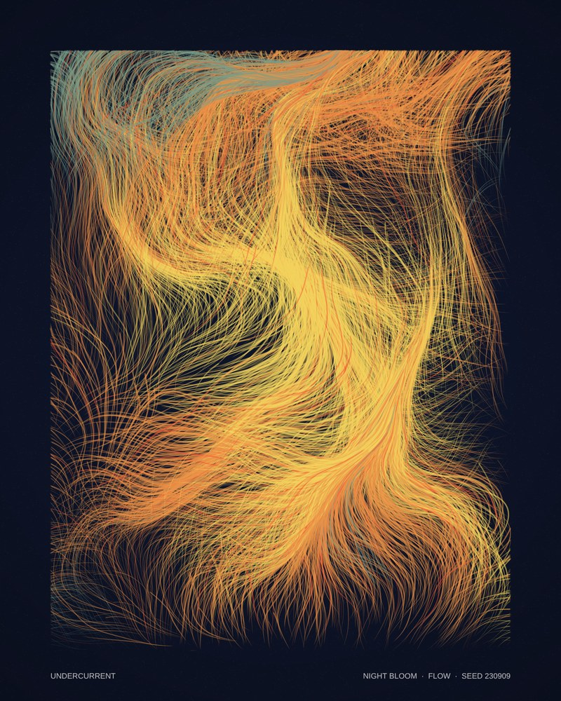
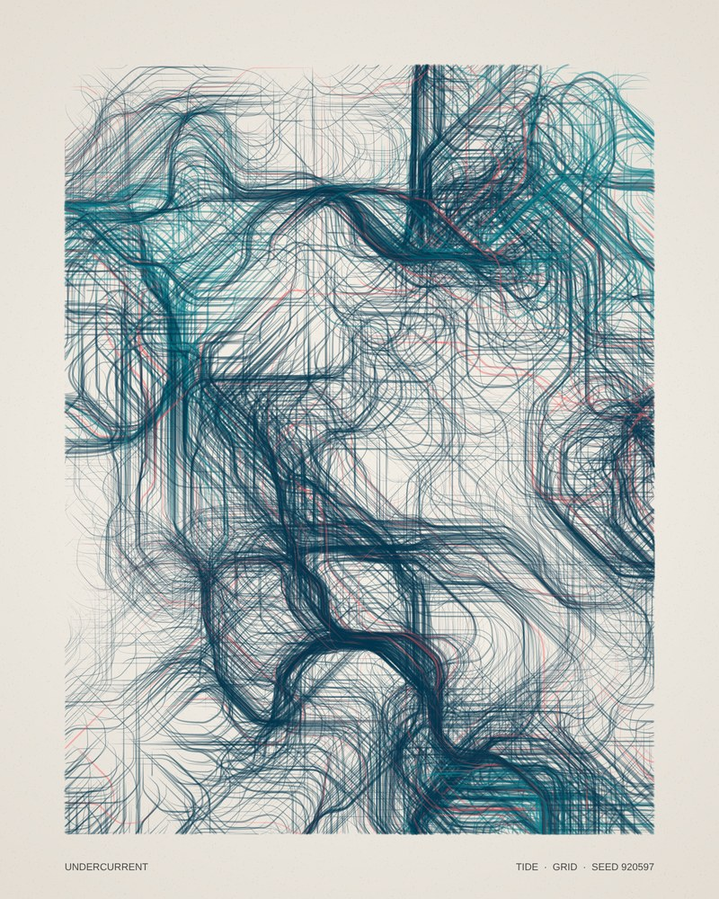
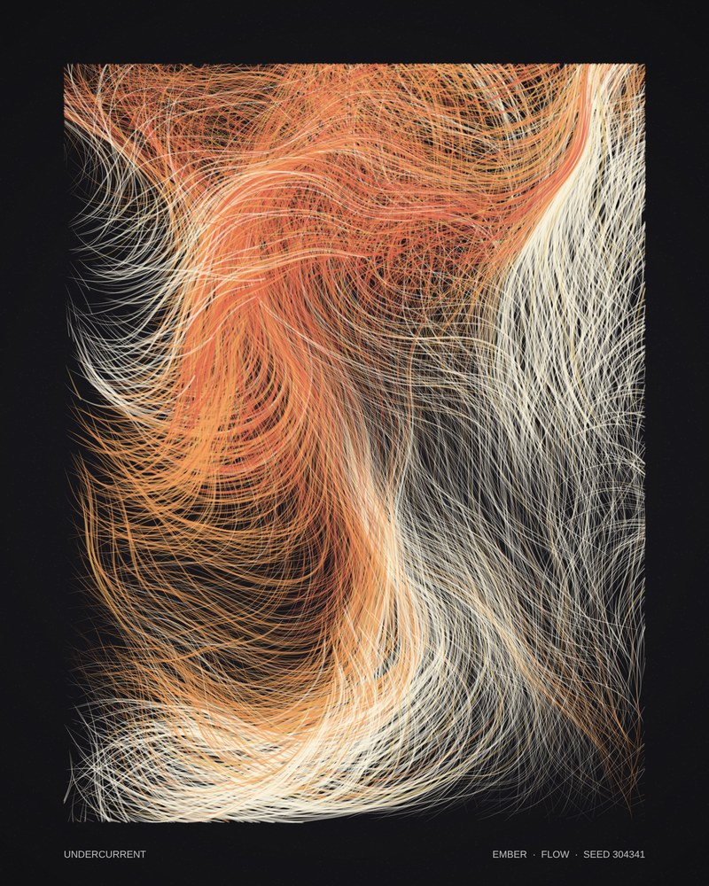
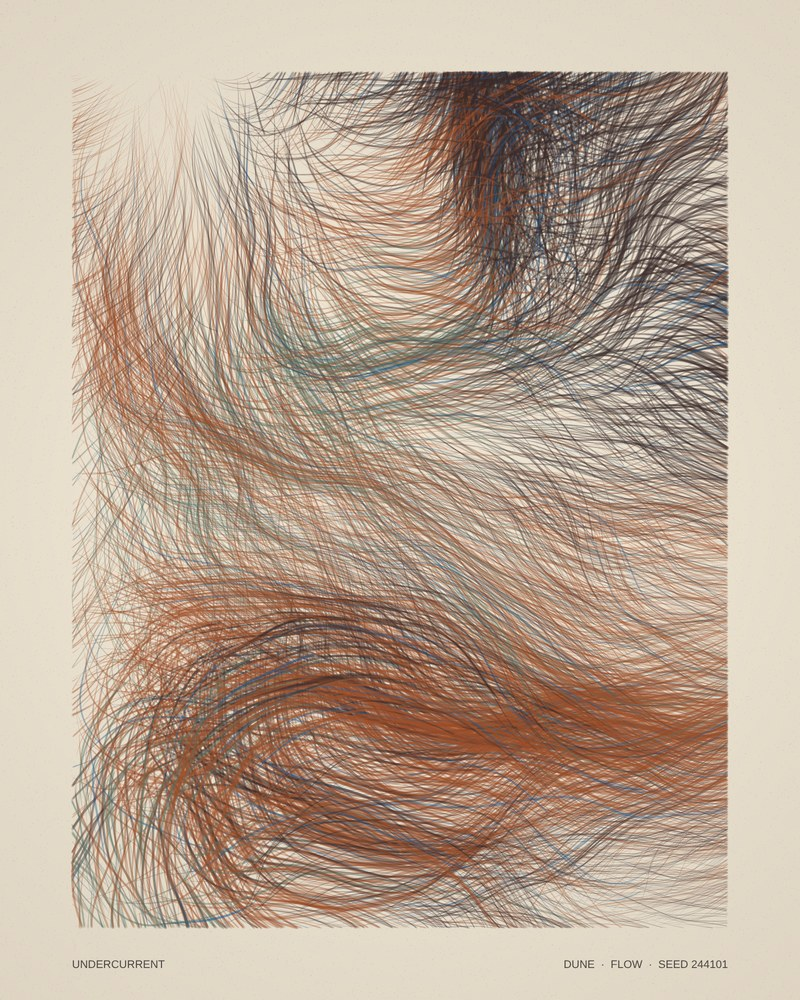
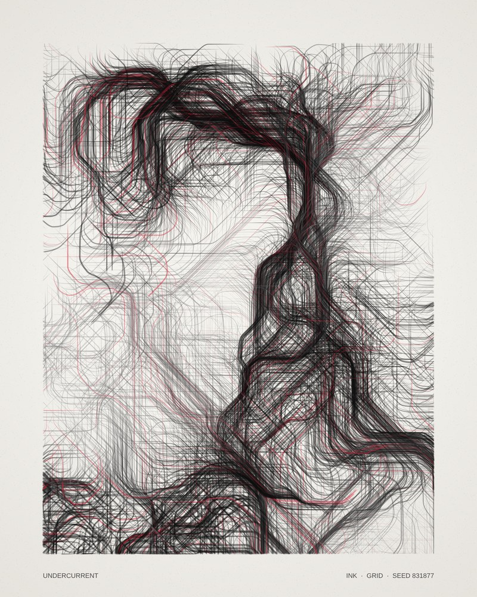
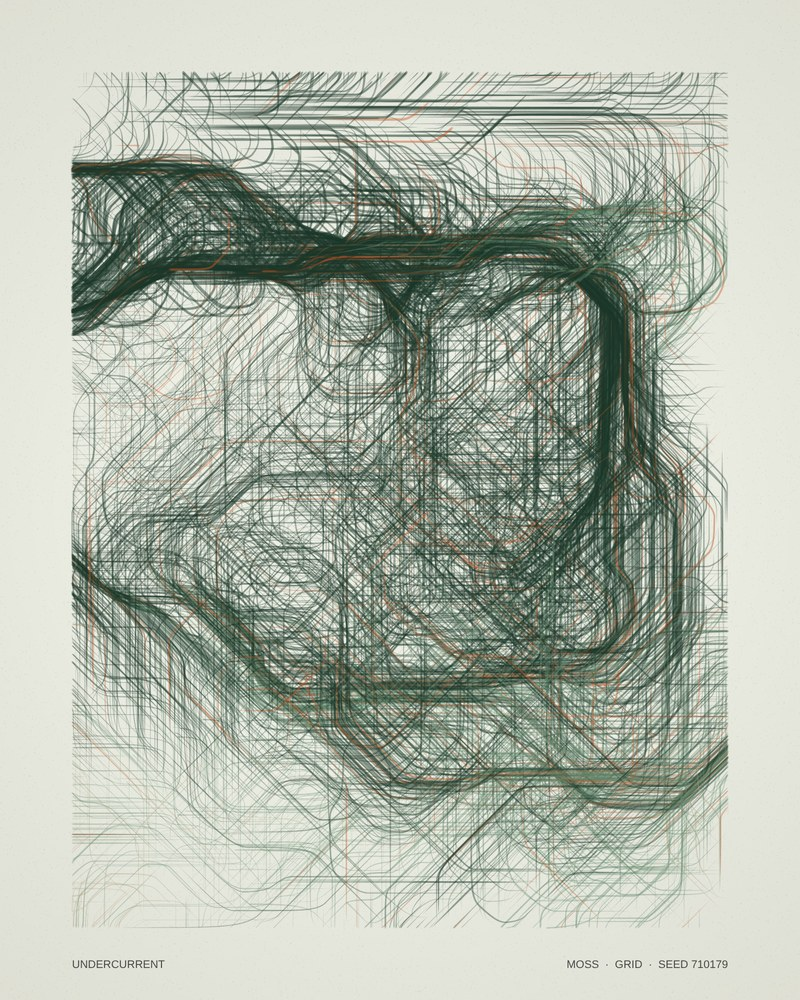

# Undercurrent

**An autonomous drawing system in p5.js** · Assignment 3-5, Autonomous Systems

**[▶ Live piece](https://driegs17-alt.github.io/Autonomous-system/)**

A thousand agents ride an invisible current and leave ink behind them. Nobody draws the picture: each run, the system rolls its own rules, and the agents follow them until the piece finishes and signs itself. You can put your hand in the water. The cursor is a whirlpool that the current bends around, and dragging pours fresh ink into the stream.

No two runs are the same, but every run is clearly Undercurrent: one series, infinite editions.

<p>
  
  
  
</p>
<p>
  
  
  
</p>

## Interaction

| Input | Action |
| --- | --- |
| **Move** the mouse | **Stir.** The current swirls around the cursor; the faster you move, the harder it pulls. The ring shows its reach. |
| **Click** | **New world.** A new seed and a new set of rules (`mousePressed()` / `mouseReleased()`). |
| **Click + drag** | **Pour ink.** Agents spill out of the cursor and drift off with the current. |
| `N` | New world |
| `G` | Switch between flow and grid mode while it draws |
| `R` | Replay this seed from the beginning |
| `S` | Save the artwork as a high-resolution PNG (`keyPressed()` → `saveCanvas()`) |
| `Space` | Pause / resume |

Leave it alone and the piece finishes itself. Once it has drawn for about 15 seconds and the mouse has been still for about 4, it prints a colophon in the bottom margin (title, palette, mode, seed), like an edition label on a print. Move the mouse over it to wake it up again.

## The system

The core idea is a split between two kinds of chance.

**`random()` makes the decisions.** It's jumpy: each value has nothing to do with the last. That suits choices that happen once.

| Decided once per world | Range |
| --- | --- |
| Seed | 0 – 999,999; reproduces the whole world |
| Palette | 1 of 6 |
| Field scale | broad swells → tight eddies |
| Twist | how far the current can turn |
| Warp | calm water → turbulent water |
| Mode | flow (70%) or grid (30%) |
| Spin | whirlpool turns clockwise or counter-clockwise |
| Population | 800 – 1,300 agents |

| Decided once per agent | |
| --- | --- |
| Birthplace, lifespan, speed, steering | each agent is a little different |
| Accent ink | about 6% of agents carry the palette's accent colour |

**`noise()` runs the behaviour.** It's smooth: nearby values are close. That suits anything that should feel natural across space or time.

- **Direction.** Each frame, an agent reads the noise field where it stands and turns it into an angle. That's the current.
- **Domain warp.** Before the lookup, a second, slower noise field nudges the position. This folds the current into richer eddies than plain noise.
- **Colour regions.** An agent takes the ink of the region it was born in, so colour forms bodies, not confetti.
- **Stroke weight.** Thick and thin neighbourhoods across the page.
- **Time.** The field slowly evolves, so early and late strokes differ.
- **Whirlpool size.** The cursor's reach breathes in and out.

If directions came from `random()`, agents would jitter in place. If the palette came from `noise()`, every run would look alike. Each tool goes where its character fits.

### The craft details

- **Inertia.** Agents steer toward the current instead of snapping to it, which gives brush-like curves. In grid mode, inertia rounds the 45° corners.
- **Tapered strokes.** Line weight swells through the middle of an agent's life and thins at both ends, like a brush touching down and lifting off.
- **Layered ink.** Strokes are translucent, so density builds up the way ink does.
- **60 / 30 / 10 colour.** Paper, three related inks spread by noise, and one accent handed out sparingly by random.
- **Paper.** A base tone, `random()` grain, and a soft radial vignette.
- **Two layers.** The artwork is drawn to an off-screen layer (`createGraphics`). The cursor ring is drawn on top each frame, so it never ends up in the artwork or in saved PNGs.
- **Constant cost.** Pouring recycles existing agents instead of adding new ones, so the frame rate never degrades.

## Run it

Open the [live piece](https://driegs17-alt.github.io/Autonomous-system/), or run it locally: open `index.html` with a local server, such as VS Code's **Live Server** extension. p5.js loads from a CDN.

## Code structure

```
index.html        page, caption and script order
css/style.css     gallery presentation; scales the 800×1000 print to any screen
js/config.js      every tunable number and all six palettes
js/agent.js       the Agent class: birth, steering, tapered stroke
js/sketch.js      world rules, noise field, whirlpool, rendering, interaction
images/           sample outputs and a screenshot
```

Arrays and loops: `agents` is an array of `Agent` objects, created in a `for` loop and stepped through with `for…of` every frame.

## Requirements checklist

- [x] `noise()` and `random()` make the decisions: position, size (stroke weight), colour, shape (flow / grid mode) and movement
- [x] Self-designed rules; every run (and every frame) is different, but every run belongs to one series
- [x] A loop and an array of objects
- [x] Mouse interaction: `mousePressed()` starts a new drawing; the whirlpool follows the mouse; dragging pours ink
- [x] Keyboard interaction: `keyPressed()` → `saveCanvas()` saves the piece, plus mode switch, replay and pause
- [x] Deliberate use of jumpy `random()` vs smooth `noise()` (see above)
- [x] Sources cited (below)

## Credits & references

- [p5.js reference](https://p5js.org/reference/): `noise()`, `noiseSeed()`, `random()`, `randomSeed()`, `createGraphics()`, `saveCanvas()`, `lerp()`, `atan2()`
- Patt Vira, *Perlin Noise* series (course resource): turning a noise value into an angle
- Daniel Shiffman, *The Coding Train*, Perlin Noise Flow Field: particles following a noise field
- Tyler Hobbs, ["Flow Fields"](https://www.tylerxhobbs.com/words/flow-fields): angle quantisation (grid mode) and composition with flow fields
- Inigo Quilez, ["Domain Warping"](https://iquilezles.org/articles/warp/): warping a noise field's input with another noise field

The code in this repository was written for this project. The sources above are where the techniques come from.
