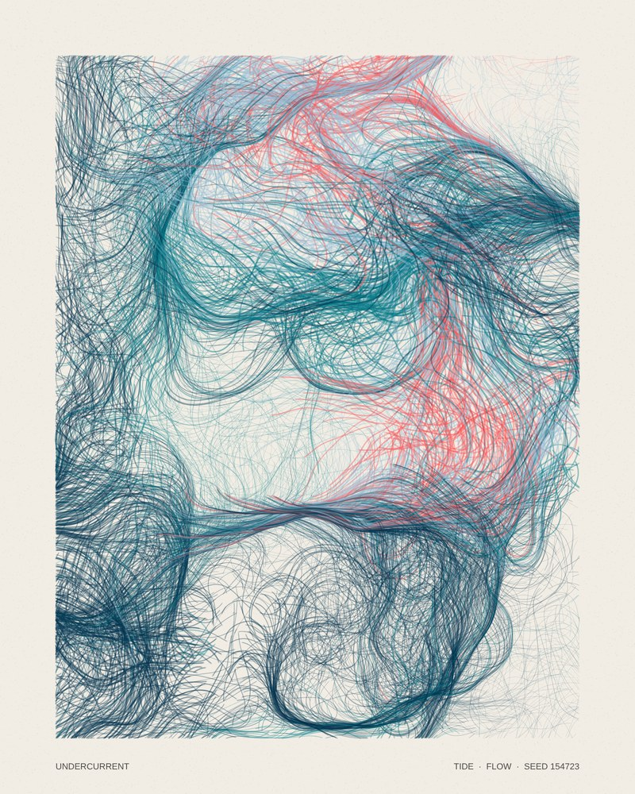
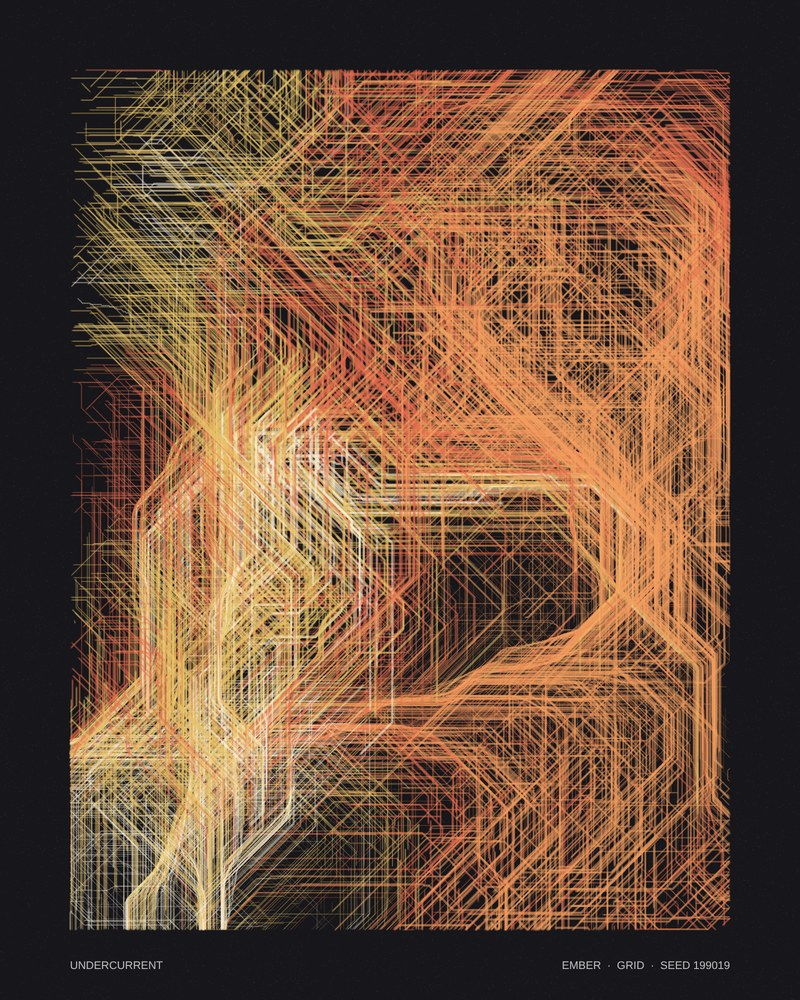
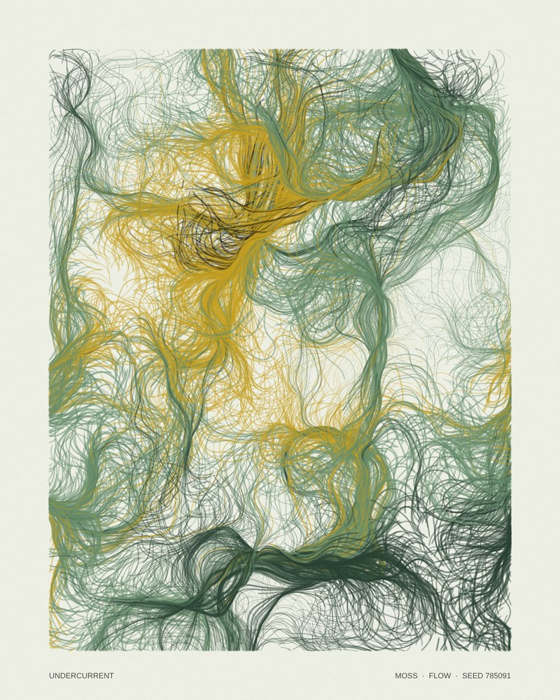
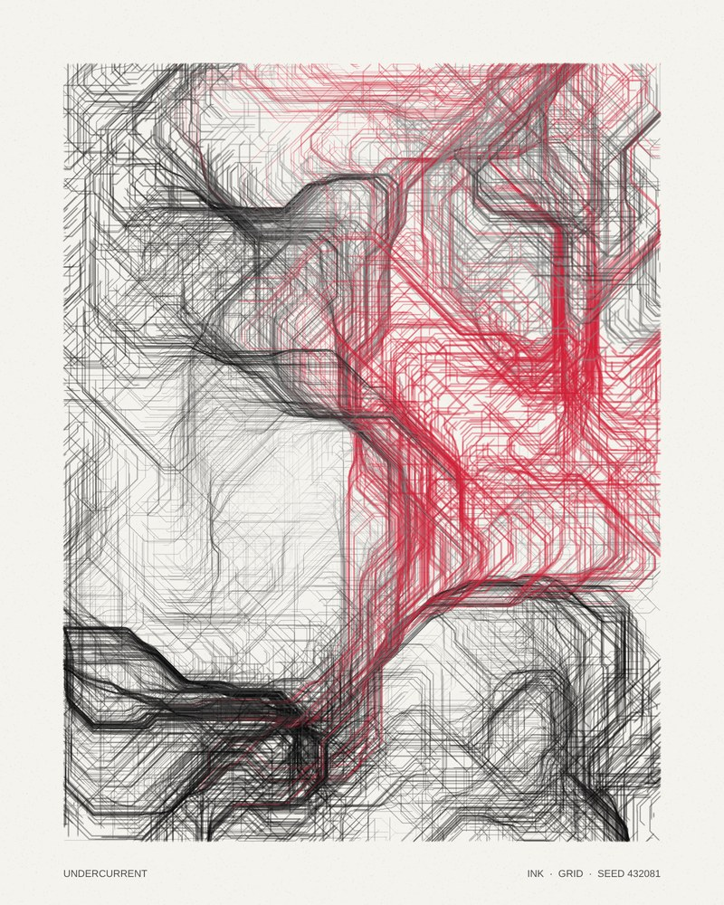
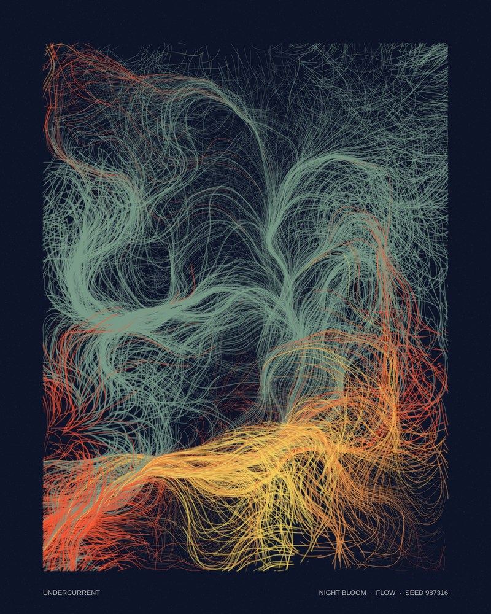
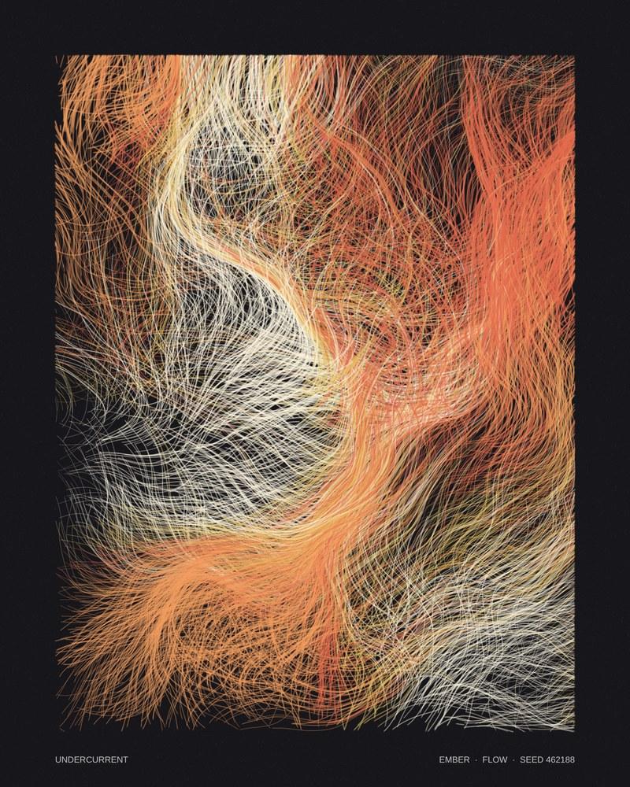

# Undercurrent

**3-5 Autonomous Systems** · generative artwork in p5.js

Undercurrent is a drawing that makes itself. Each time it runs, the sketch sets up a new "world" of rules. Then about 1,000 agents drift across the page, following an invisible current made with Perlin noise. Nobody steers them. The drawing builds up layer by layer and stops on its own after about 15 seconds. When it stops, it prints a label at the bottom, like a numbered print.

Every result is different, but they all come from the same rules, so they read as one series.

<p>
  
  
  
</p>
<p>
  
  
  
</p>

## Run it

Open `index.html` in a browser, or use the VS Code **Live Server** extension. p5.js loads from a CDN, so you need an internet connection.

To use the p5.js Web Editor instead, paste `sketch.js` into the editor's `sketch.js` file. `createCanvas(W, H).parent('stage')` expects a `<div id="stage">`, so either add one to the editor's `index.html` or change that line to `createCanvas(W, H);`.

## Controls

| Input | Action |
| --- | --- |
| Click (or `N`) | New drawing with a new seed |
| `R` | Replay the same seed. The same rules give the same drawing. |
| `S` | Save the canvas as `undercurrent-<seed>.png` |
| `Space` | Pause / resume |

## The rules

**At the start, `random()` decides each of these once:**

1. **Seed:** one number controls everything below, so any drawing can be recreated.
2. **Palette:** one of five palettes (Tide, Ember, Moss, Ink, Night Bloom).
3. **Field scale:** how zoomed-in the current is (wide, slow swells or tight eddies).
4. **Twist:** how far the current can turn.
5. **Mode:** `flow`, with smooth curves, 70% of the time, or `grid`, which snaps directions to 45° steps, 30% of the time.
6. **Population:** 700 to 1,200 agents.

**While it draws, `noise()` decides these continuously:**

- **Direction:** each agent reads the noise value at its position and turns it into an angle, then takes a step.
- **Colour:** each agent's ink comes from a second noise layer, so neighbouring agents share colours and form regions.
- **Line weight:** a third noise layer makes thick and thin areas instead of random speckle.
- **Time:** the current slowly changes as the drawing runs, so early strokes and late strokes differ slightly.

**Each agent's lifecycle:** an agent is born at a random spot, lives for a random number of frames, and is reborn somewhere new when it dies or leaves the margin.

## Why random() *and* noise()?

- `random()` is **jumpy**: each call has nothing to do with the one before it. That suits one-time decisions (which palette? which mode?) and texture that should feel uneven, like the paper grain.
- `noise()` is **smooth**: values next to each other are close. That suits anything that should feel natural and continuous, like the flow of the current and the colour regions. If the directions used `random()`, the agents would jitter in place instead of flowing.

## Requirements checklist

- [x] `noise()` and `random()` make decisions about position, size (line weight), colour, shape (mode) and movement
- [x] Every run is different but looks like the same piece (a seeded rule set)
- [x] Array of objects (`particles[]` of `Particle`) and loops
- [x] Mouse interaction (`mousePressed()` makes a new drawing) and keyboard interaction (`keyPressed()` saves, replays and pauses)
- [x] `saveCanvas()` export

## Files

```
index.html   page + p5.js CDN
sketch.js    the generative system (commented)
style.css    page layout; scales the 800×1000 canvas to fit the screen
images/      example outputs
```

## Credits & references

- [p5.js](https://p5js.org) and its `noise()` / `random()` reference pages
- Patt Vira, *Perlin Noise* series (course resource): the flow-field idea of turning a noise value into an angle
- Daniel Shiffman, *The Coding Train*, "Perlin Noise Flow Field" coding challenge: particles following a noise field
- Tyler Hobbs, ["Flow Fields"](https://www.tylerxhobbs.com/words/flow-fields): angle quantising (the `grid` mode idea) and composition with flow fields

The code in this repo was written for this project. The references above are where the techniques came from.
